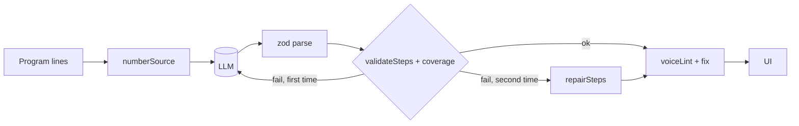

# Design Document: ghost-narrator

## Overview
Narration is generated from **numbered** source so ranges are grounded, then validated and repaired by pure functions before the UI sees it. Voice rules are enforced in code, not only in the prompt.

## Components and Interfaces
| Module | Signature |
|---|---|
| `src/lib/cobolLines.ts` | `procedureLines(lines: string[]): number[]` (1-based, skips blanks, `*` comments in col 7, and lines before `PROCEDURE DIVISION`) |
| `src/lib/coverage.ts` | `uncovered(steps, lines): number[]` |
| `src/lib/repairSteps.ts` | `repairSteps(steps, lineCount, mustCover): Step[]` (clamp → sort → merge overlaps → append coverage step) |
| `src/lib/voiceLint.ts` | `lint(step): Issue[]`, `fixVoice(step): Step` |
| `api/ask.ts` | `{ mode: 'lines'|'mismatch', question?, range?, sourceLines, outputs? } → { answer }` |
| `api/summon.ts` (`mode:'fix'`) | adds `previousSource`, `compileError` to the prompt |

Word-by-word reveal: split on spaces into ``s and animate opacity with `animation-delay: calc(var(--i) * 30ms)`; only the active step animates.

## Correctness Properties

**Property 1: Repair always yields valid steps**
*For any* list of arbitrary integer ranges and any `lineCount ≥ 1`, `validateSteps(repairSteps(steps, lineCount, mustCover), lineCount)` passes.
**Validates: Requirements 1.1, 1.3**

**Property 2: Repair achieves full coverage**
*For any* steps and any `mustCover ⊆ [1, lineCount]`, `uncovered(repairSteps(...), mustCover)` is empty.
**Validates: Requirements 1.2, 1.3**

**Property 3: Repair keeps valid input unchanged**
*For any* steps that already pass validation and coverage, `repairSteps` returns them unchanged.
**Validates: Requirements 1.3**

**Property 4: Voice fix converges**
*For any* step text, `lint(fixVoice(step))` contains no word-count, emoji or banned-word issue.
**Validates: Requirements 2.1, 2.2**

**Property 5: Python maps stay in range**
*For any* PyLine list after sanitizing, every non-null `maps` satisfies `1 ≤ a ≤ b ≤ lineCount`.
**Validates: Requirements 1.4**

## Error Handling
- `/api/ask` failures show "The ghost is quiet right now." under the step; nothing else changes.
- Fix_Loop counter lives in the séance reducer and resets on a new task.

## Testing Strategy
- fast-check for Properties 1–5.
- Example tests: `procedureLines` on the golden sales program; voice lint on a list of known-bad strings.
