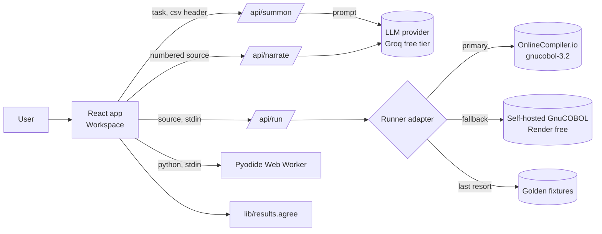
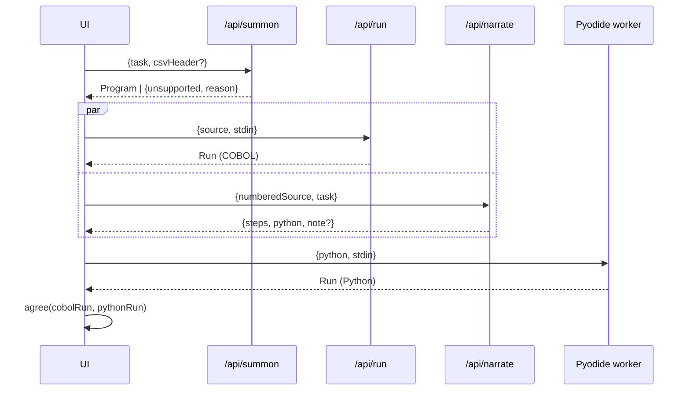

# Design Document: seance-core

## Overview

Séance is a static React + Vite app on Vercel with three Vercel Functions. The LLM never runs code and the browser never holds keys. A séance is a pipeline:

1. **Summon** (`/api/summon`): task → COBOL `Program`.
2. **Run COBOL** (`/api/run`): source + stdin → `Run` (real GnuCOBOL 3.2 through the runner adapter).
3. **Narrate** (`/api/narrate`): numbered COBOL → `Step[]` + `PyLine[]` + optional note. Sending numbered lines keeps every range grounded in the real source.
4. **Run Python** (Pyodide worker in the browser): Python + same stdin → `Run`.
5. **Agree** (pure function): COBOL `Run` vs Python `Run` → `Agreement`.

Steps 2 and 3 run in parallel once the program arrives. Step 4 starts when Python lines arrive.

### Why this runtime approach
Compiling arbitrary, freshly generated COBOL fully inside the browser is not realistic in a two-week build. Existing COBOL→WebAssembly work (Cloudflare's GnuCOBOL + Emscripten build, `moxon6/cobol-js-emscripten`, `ancientwasm`) compiles each program **ahead of time** with `cobc` → C → `emcc`. That needs a C toolchain at compile time, and no maintained in-browser `cobc` exists. So COBOL runs on a real GnuCOBOL compiler behind `/api/run`, and Python runs in the browser through Pyodide. A browser-only COBOL path is a stretch item for the golden fixtures only (see proof-runner).

## Architecture





## Components and Interfaces

### Client state (one reducer, `src/state/seance.ts`)
```ts
type Phase = 'idle' | 'summoning' | 'running' | 'narrating' | 'ready' | 'error';
type SeanceState = {
  phase: Phase;
  task: string; csv?: { name: string; rows: number; text: string };
  program?: Program; cobolRun?: Run; steps: Step[]; python: PyLine[]; note?: string;
  pythonRun?: Run; agreement?: Agreement; activeIndex: number;
  error?: { kind: 'compile'|'runtime'|'timeout'|'unsupported'|'busy'|'invalid'; message: string; line?: number; token?: string };
  cached: boolean;
};
```
`activeIndex` is the single source of truth for linked highlighting. `CodePane`, `GhostNarration`, `TranslationPane` and `GhostCaption` all derive their highlight from `steps[activeIndex].range` through `lib/ranges.ts`.

### UI components
Names, props and states exactly as in `.kiro/steering/seance-design.md` (AppShell, TopBar, TaskInput, FileChip, SummonButton, StatusPill, LanguageTrigger, LanguagePicker, LanguageCard, Pane, CodePane, Planchette, GhostNarration, TranslationPane, RunOutput, AgreementBar, SegmentedControl, GhostCaption, EmptyState, SummoningSkeleton, ErrorState, Chip, Kbd).

### API contracts (`src/lib/schemas.ts`, zod)
```ts
Program = { language: 'cobol'; dialect: 'cobol85-fixed'; filename: string; title: string; lines: string[] /* 1..120 */ }
SummonReq = { task: string /* ≤500 */; csvHeader?: string; language: 'cobol' }
SummonRes = { program: Program } | { unsupported: true; reason: string }
RunReq  = { language: 'cobol'|'fortran'|'basic'; source: string /* ≤20000 */; stdin: string /* ≤70000 */ }
Run     = { stdout: string; stderr?: string; exitCode: number; timedOut?: boolean;
            compileError?: { line?: number; message: string } ; runner: 'onlinecompiler'|'selfhost'|'fixtures'|'pyodide' }
NarrateReq = { task: string; numberedSource: string; lineCount: number }
NarrateRes = { steps: Step[]; python: PyLine[]; note?: string }
Step   = { range: [number, number]; quote?: string; text: string }
PyLine = { text: string; maps: [number, number] | null }
Agreement = { status: 'match'|'mismatch'|'no-result'; cobolValue?: string; pythonValue?: string; label?: string }
```

### Pure library (`src/lib`)
| Module | Responsibility |
|---|---|
| `ranges.ts` | `intersects(a,b)`, `validateSteps(steps, lineCount)`, `firstLine(range)` |
| `stdin.ts` | `encodeStdin(csvText?) → string`, `decodeStdin(s) → string[]` (protocol in proof-runner) |
| `results.ts` | `parseResultLines(stdout) → Map<label, raw>`, `normalizeNumber(raw)`, `agree(a,b) → Agreement` |
| `lineOffset.ts` | `remapCompilerMessage(msg, offset)` |
| `numbering.ts` | `numberSource(lines) → "0001  …"` for the narrate prompt |

### Golden séances
`src/fixtures/golden/<slug>.json` holds a full `Séance` captured by `npm run golden:capture` (a script that calls the real APIs and saves the responses). They are replayed with the same animations. Each file records `capturedAt` and `runner`.

Sample input for the "Total the sales in a CSV" chip (`src/fixtures/golden/sales.csv`):
```
region,amount
North,1520.25
South,980.00
East,2105.75
West,1265.50
```
These four amounts sum to 5871.50, which matches the design mocks.

## Data Models
See schemas above. All numbers are 1-based line numbers. `Program.lines` never includes the `>>SOURCE FORMAT IS FIXED` directive; the runner adds it.

## Correctness Properties

*A property is a characteristic that should hold across all valid executions. Each one becomes a fast-check test.*

**Property 1: Highlight follows intersection**
*For any* Active_Range `[a,b]` and any PyLine with `maps [c,d]`, the line is highlighted if and only if `c ≤ b` and `d ≥ a`; lines with `maps = null` are never highlighted.
**Validates: Requirements 5.4**

**Property 2: Valid steps stay inside the program**
*For any* `lineCount ≥ 1` and any step list accepted by `validateSteps`, every range satisfies `1 ≤ a ≤ b ≤ lineCount`, ranges are in ascending order and do not overlap.
**Validates: Requirements 5.2, 5.3**

**Property 3: Planchette target is the first line**
*For any* valid step, `firstLine(step.range) === step.range[0]`, and moving `activeIndex` by `j`/`k` never leaves `[0, steps.length-1]`.
**Validates: Requirements 5.3, 5.5**

**Property 4: Agreement is symmetric and reflexive**
*For any* stdout `s` containing at least one Result_Line, `agree(s, s).status === 'match'`; *for any* `s1, s2`, `agree(s1,s2).status === agree(s2,s1).status`.
**Validates: Requirements 7.2, 7.3**

**Property 5: Number formatting does not break agreement**
*For any* decimal value `v` with up to 2 fractional digits, the COBOL edited form (leading spaces or zeros, trailing `.00`) and Python's `str(Decimal)` form normalize to the same value.
**Validates: Requirements 7.2**

**Property 6: Any real difference is caught**
*For any* two Result_Line sets that differ in a label or in a normalized value, `agree` returns `mismatch`.
**Validates: Requirements 7.3**

**Property 7: Input limits**
*For any* string longer than the documented limits, the request schemas reject it.
**Validates: Requirements 1.5, 1.7, 3.7, 12.2**

**Property 8: Rate limit holds in every window**
*For any* sequence of hit times for one key, the limiter allows at most `limit` hits inside any window of `windowMs`, and every rejected hit gets a Retry-After of at least 1 second.
**Validates: Requirements 12.3**

**Property 9: The response cache stays bounded**
*For any* sequence of `set` and `get` calls, the LRU cache never holds more than `max` entries and always returns the value most recently set for a key it still holds.
**Validates: Requirements 12.4**

## Error Handling
| Case | Detected by | UI state |
|---|---|---|
| LLM JSON invalid | zod in Summon/Narrate API, one silent retry | `invalid`: "The ghost mumbled. Summon again." |
| Unsupported task | `SummonRes.unsupported` | unsupported card |
| Compile error | `Run.compileError` | compile state, underline line, "Let the ghost fix it" |
| Runtime error | `exitCode ≠ 0` | runtime state, stderr in danger |
| Timeout | `Run.timedOut` | timeout state |
| 429 / 5xx anywhere | fetch wrapper | busy state + chips |
| Results differ | `agree` | danger AgreementBar |

## Testing Strategy
- **Property tests (fast-check)** for every Correctness Property, in `tests/*.property.test.ts`, at least 200 runs each.
- **Example tests (Vitest)** for zod schemas, reducer transitions and the fetch wrappers (mocked fetch).
- **Golden replay test:** every file in `src/fixtures/golden/` parses with the schemas and its stored COBOL and Python runs `agree` → `match`.
- **Manual/E2E (stretch):** Playwright smoke on the sales golden séance.
