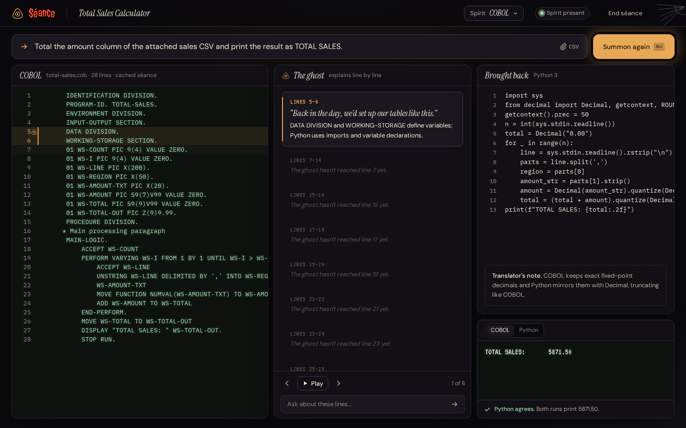

# Séance

*Ask in plain English. A programmer from 1959 answers.*

**Live:** https://seance-psi.vercel.app



## What it does

1. **Ask.** Type a task in plain English ("parse this CSV and total the sales"), or pick one of four suggestion chips. You can attach a small CSV (up to 64 KB and 500 rows).
2. **COBOL.** The model writes a fixed-format COBOL-85 program. It compiles and runs on a real GnuCOBOL compiler, and the output streams into a CRT-style pane.
3. **The ghost explains.** A "ghost programmer" walks through the program step by step. Each step lights a range of COBOL lines, the planchette glides to it, and the matching Python lines light up too.
4. **Python proof.** The program is translated to Python and run. The agreement bar compares both runs: "Python agrees. Both runs print 5871.50."

The four suggestion chips replay saved ("golden") séances, so they work even when the LLM provider is rate-limited. COBOL is the only language that answers today. Fortran and BASIC appear in the picker as "Resting".

Python runs in your browser. COBOL runs on a real GnuCOBOL compiler. Generated code is for learning, not production.

## Kiroween category: Resurrection

Séance brings a dead language back to life. COBOL is nearly 70 years old, and most developers never see it. Séance lets you describe a task you already understand, watch how it was done in 1959, hear each line explained, and see the same answer come back from modern Python. The haunted-house look (a charcoal card, cobwebs, a jack-o'-lantern terminal) is only on the landing page. The workspace stays calm and readable.

## How Kiro was used

Everything here was built through Kiro specs, steering, hooks and a custom agent. All of it is committed in [`.kiro/`](.kiro).

- **Specs** in [`.kiro/specs/`](.kiro/specs): `seance-core` (requirements, design with nine correctness properties, 16 tasks), `proof-runner` and `ghost-narrator`. Tasks were run one at a time against the numbered requirements.
- **Steering** in [`.kiro/steering/`](.kiro/steering), using all four inclusion modes:
  - always: `product.md`, `tech.md`, `structure.md`, `seance-design.md`
  - fileMatch: `cobol-generation.md`
  - auto: `cobol-primer.md`
  - manual: `demo-day.md`
- **Hooks** in [`.kiro/hooks/`](.kiro/hooks): block secrets in written files, guard `.kiro/` and `LICENSE`, log each finished task, and run related tests on save.
- **Custom agent:** [`cobol-elder`](.kiro/agents/cobol-elder.md), a read-only reviewer for generated COBOL, fixtures and narration.
- **MCP:** [`.kiro/settings/mcp.json`](.kiro/settings/mcp.json).
- **Property-based tests:** fast-check properties for range highlighting, agreement, input limits, the rate limiter and the response cache.

The task-by-task history is in [`docs/kiro-log.md`](docs/kiro-log.md).

## Stack

- TypeScript (strict), React 19, Vite
- Vercel (static build plus Vercel Functions in `api/`)
- LLM: any OpenAI-compatible provider; default Groq free tier
- COBOL runner: OnlineCompiler.io (GnuCOBOL 3.2) through a server-side `/api/run` proxy
- Python runner: Pyodide in a Web Worker (standard library only)
- zod for every LLM and runner response
- Vitest, fast-check, Playwright (chromium)

The whole project runs on free tiers, and API keys stay on the server.

## Run locally

Requires Node.js and npm.

```bash
npm ci
cp .env.example .env     # on Windows PowerShell: Copy-Item .env.example .env
npm run dev
```

Fill in `.env` with your own values. The variable names are:

| Name | Purpose |
|---|---|
| `LLM_API_KEY` | LLM provider key |
| `LLM_BASE_URL` | Provider base URL (default: Groq's OpenAI-compatible endpoint) |
| `LLM_MODEL` | Model id for summoning |
| `LLM_NARRATE_MODEL` | Optional separate model for narration |
| `RUNNER_KIND` | `onlinecompiler`, `selfhost` or `fixtures` |
| `ONLINECOMPILER_API_KEY` | Key for OnlineCompiler.io |
| `SELFHOST_RUNNER_URL` | Self-hosted runner URL (only with `selfhost`) |
| `SELFHOST_RUNNER_TOKEN` | Self-hosted runner token (only with `selfhost`) |

Never commit `.env`. It is git-ignored, and a test fails if any of these names or values end up in the client bundle.

Other commands:

```bash
npm test          # unit, property and component tests (Vitest)
npm run build     # type-check and production build
npm run smoke     # Playwright smoke test against a local preview
```

The smoke test builds the app and serves it on port 4173. To test a deployed site instead, set `SMOKE_BASE_URL`:

```powershell
$env:SMOKE_BASE_URL = 'https://seance-psi.vercel.app'; npm run smoke
```

The first time, install the browser with `npx playwright install chromium`.

## License

[MIT](LICENSE), Copyright (c) 2026 Douglas Godwin Michael.
